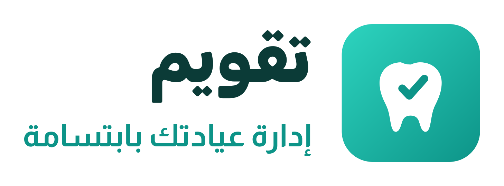
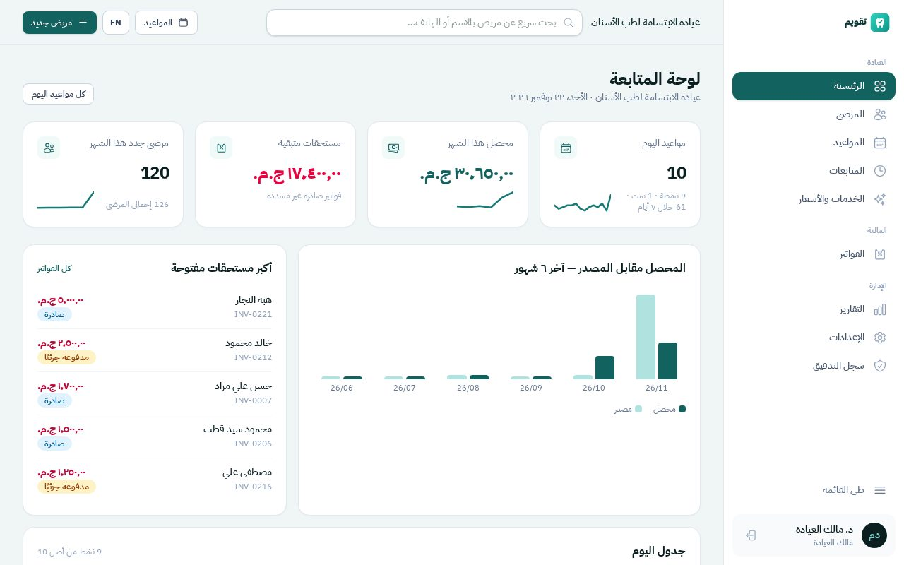
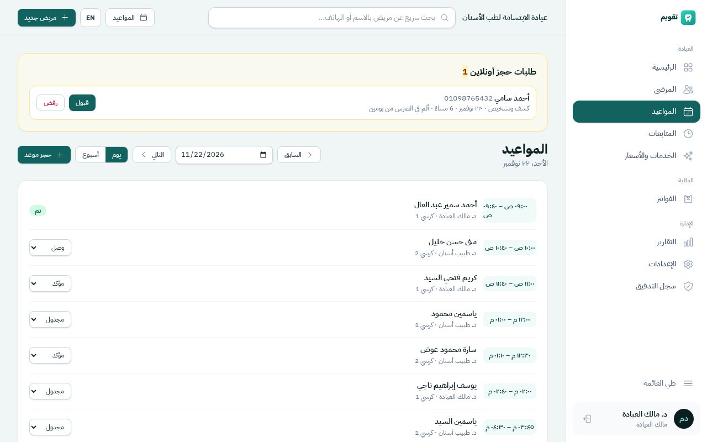
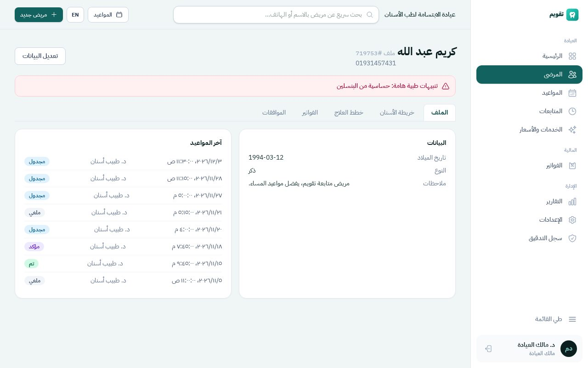
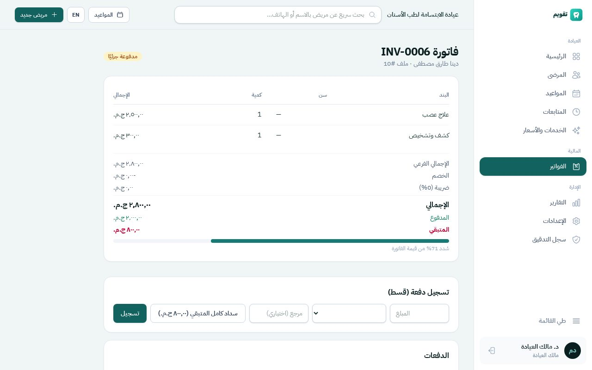

<div align="center">
  <picture>
    <source media="(prefers-color-scheme: dark)" srcset="public/brand/taqwim-lockup-slogan-dark.svg">
    
  </picture>

  <h1>تقويم · Taqwim</h1>
  <p><strong>Multi-tenant dental clinic management, Arabic-first.</strong><br>
  إدارة عيادتك بابتسامة — patients, appointments, treatment plans, billing and recalls in one place.</p>

  <p>
    <a href="#what-this-is">What this is</a> ·
    <a href="#screenshots">Screenshots</a> ·
    <a href="#features">Features</a> ·
    <a href="#ask-claude-about-your-clinic">Claude connector</a> ·
    <a href="#the-stack">Stack</a> ·
    <a href="#quick-start">Quick start</a> ·
    <a href="#configuration">Configuration</a>
  </p>

  <p>
    
    
    
    
  </p>
</div>

## What this is

Taqwim is a SaaS for dental clinics in Egypt and the Gulf. Each clinic gets its own isolated workspace: staff with roles, patient files with an FDI odontogram, treatment plans, chair-time scheduling, invoices and payments, recall follow-ups, and an optional public booking page.

**The interface is Arabic-first and fully RTL, with a complete English locale alongside it.** Clinical records, money and schedules are modeled for how a dental practice actually runs, not adapted from a generic CRM.

One rule the codebase holds to: no clinic can ever see another clinic's data. Tenant isolation is enforced by a global scope on every tenant model, and cross-clinic access returns 404 — this is covered by tests, not by convention.

## Screenshots

<p align="center">
  
  
  
  
</p>

English variants of the same screens live in <code>public/landing/</code>.

## Features

| Area | What it is |
| --- | --- |
| Tenancy & staff | Clinics, branches, roles (owner / dentist / receptionist / assistant). Global-scope isolation, 404 across tenants. |
| Patients | File numbers, contact + WhatsApp, alerts, notes, national ID encrypted at rest. |
| Odontogram | Interactive FDI chart, per-tooth conditions and surfaces, RBAC-gated edits. Layout follows FDI notation orientation; it is not a clinical certification. |
| Treatment plans | Draft → proposed → accepted → in progress → completed, priced items per tooth. |
| Appointments | Branch / dentist / chair booking with overlap protection, day view, status flow. Stored in UTC from clinic-local time. |
| Billing | Invoices from accepted plan items, payments, partial payment states, sequential per-clinic numbers. Tax is a per-clinic rate the clinic sets itself; 0 by default — no statutory rate is shipped or implied. |
| Recalls | Due/overdue follow-up lists per clinic. |
| Online booking | Optional public booking page per clinic (token URL, off until enabled) with request approval. |
| WhatsApp | A button that opens a prepared chat on the staff device. It does not send anything by itself. |
| Reports | Revenue and activity summaries per clinic. |
| Platform admin | Separate platform staff area for managing organizations; inactive organizations keep working (no hard paywall yet — plan tiers are an open owner decision). |

## Ask Claude about your clinic

Taqwim ships a **read-only Claude connector**: a clinic owner can link their own Claude account and ask questions like "what are today's appointments?", "which recalls are overdue?" or "how much was collected this month?" — in Arabic or English, without opening the dashboard.

It is an OAuth 2.1 + PKCE authorization server plus an MCP endpoint with five read-only tools (`today_schedule`, `search_patients`, `get_patient`, `recalls_due`, `revenue_summary`). The rules it holds to:

- **Read-only.** It cannot add, change or delete anything, and cannot message patients.
- **No clinical data.** No treatment plans, medical history, odontogram or clinical notes.
- **Owner-controlled.** Only the clinic owner can enable it, approve a connection, or revoke it — any time, from Settings. Off by default.
- **Scoped to one clinic.** A token only ever sees its own clinic, and eligibility is re-checked on every call.
- **Your Claude account.** Data goes to your own Claude account under your terms with Anthropic. A separate Claude plan is required, and there is no AI assistant inside Taqwim itself.

The connector is new and has not been tried with a real Claude account yet.

## The stack

| Layer | Tech |
| --- | --- |
| Backend | Laravel 13, PHP 8.3+ |
| Frontend | Vue 3 + Inertia, Tailwind CSS 4 |
| Database | MySQL 8 / MariaDB 10.6 (validated on 10.6.23); SQLite for local dev and tests |
| Auth | Session auth for staff; OAuth 2.1 + PKCE (S256) for AI connectors |

### Layout

| Path | Purpose |
| --- | --- |
| `app/Models` | Tenant models behind the `BelongsToClinic` global scope, platform models |
| `app/Http/Controllers` | Clinic features, settings, OAuth + MCP endpoints |
| `resources/js/Pages` | Inertia pages (AR/EN), RTL layout |
| `resources/js/i18n.js` | UI string catalog; user and clinical data is never translated |
| `database/migrations` | Schema — MariaDB 10.6 compatible (`DATETIME`, named indexes) |
| `database/seeders` | Synthetic demo clinic (fictional data only) |
| `tests` | 75 feature/unit tests, 395 assertions |

### Rules the codebase holds to

1. Money is stored as integer minor units; totals are computed server-side.
2. No statutory tax rate, price, trial length or commercial term is hard-coded — clinics and the platform owner set their own.
3. New tenant features must not degrade existing clinics: migrations are additive and defaults are off.

## Quick start

```sh
composer install
cp .env.example .env
php artisan key:generate
touch database/database.sqlite
php artisan migrate --seed
npm install && npm run build
php artisan serve
```

The seeder creates a fully synthetic demo clinic (عيادة الابتسامة) with fictional patients, plans, appointments and invoices. Log in as `owner@asnan.test` — password `password` in local env, or the value of `DEMO_PASSWORD` when set. Outside local env the seeder **requires** `DEMO_PASSWORD` and refuses to run without it, so no reusable default credential ever reaches a deployment.

Run the tests:

```sh
php artisan test
```

The same suite passes against MariaDB 10.6.23:

```sh
DB_CONNECTION=mysql DB_HOST=127.0.0.1 DB_PORT=3306 \
DB_DATABASE=asnan_test DB_USERNAME=root DB_PASSWORD= \
php artisan test
```

## Configuration

| Variable | What to put in it |
| --- | --- |
| `APP_URL` | The clinic platform URL. |
| `DB_*` | MySQL/MariaDB for production; SQLite works locally. |
| `DEMO_PASSWORD` | Required to run the demo seeder outside local. Keep it out of git. |
| `PLATFORM_TRIAL_DAYS` | Unset = no trial. Trials are an undecided commercial term; do not set without an owner decision. |
| `PLATFORM_SALES_WHATSAPP` | Empty = neutral "contact us" activation state on pricing. |

Shared-host (cPanel) deploys: see [docs/deployment.md](docs/deployment.md) for the host PHP handler block every deploy must preserve and the live host's nonsecret configuration choices.

## Not built yet

Automatic WhatsApp sending, SMS and email notifications, online payment, insurance claims, a native mobile app, and an AI assistant inside the product itself. The landing page says the same to visitors.

## License

No license has been selected yet; all rights reserved by the author until one is chosen.
